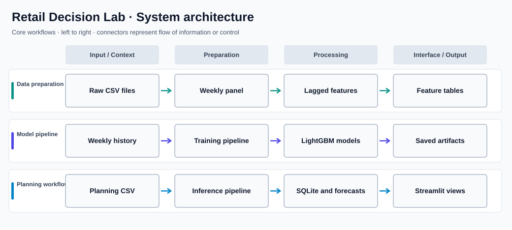

# Retail Decision Lab

**Retail demand forecasting and decision-support workspace**

## Overview

Retail Decision Lab is a Python and Streamlit application for exploring retail demand and turning historical sales patterns into practical planning inputs. It uses the Corporación Favorita store-sales dataset and brings forecasting, promotion analysis, SQL exploration, and next-week planning into a single workflow.

### Why this project matters

Retail planning involves decisions at multiple levels: overall demand, individual stores, and product families. The application connects a reproducible machine-learning pipeline with interactive views so those questions can be explored without working directly in notebooks.

## Key capabilities

- Builds a store-and-product-family weekly demand panel from the official Kaggle source files.
- Creates time-aware demand, transaction, calendar, and promotion features without using future observations.
- Trains forecasting candidates and persists selected models for later inference.
- Provides Streamlit views for executive demand, store/product-family exploration, and forecast monitoring.
- Explores promotion associations and demand-spike patterns without presenting observational relationships as causal effects.
- Builds reusable SQLite analytical marts using SQL window functions and aggregations.
- Accepts a next-week planning CSV for scenario-oriented forecast generation.

## System architecture



The diagram organizes the major flows into aligned lanes to make their responsibilities and handoffs clear. It is a high-level view; individual modules may also communicate across lanes.

### How it works

The pipeline first consolidates raw Favorita tables into a complete weekly panel. Feature generation uses lagged demand and other information available at planning time. Forecasting and classification artifacts are persisted separately from the dashboard, while SQLite provides reusable queries for the analytics views.

A planning upload supplies known next-week calendar and promotion inputs. The inference path combines those inputs with historical features and produces forecasts for exploration in Streamlit.

## Technology stack

| Technology | Purpose |
| --- | --- |
| **Python / pandas** | Data preparation, feature engineering, orchestration |
| **LightGBM / scikit-learn** | Forecasting and classification models |
| **Streamlit / Plotly** | Interactive decision-support interface |
| **SQLite / SQL** | Reusable analytical marts and queries |
| **Docker** | Containerized application startup |

## Repository structure

```text
app/                       Streamlit dashboard
src/favorita_benchmark.py  Forecasting and model selection
src/favorita_analytics.py  Promotion, classification, SQL marts
src/favorita_inference.py  Planning-file inference
run_favorita_pipeline.py   End-to-end pipeline entry point
data/                      Local input and analytical data
models/                    Saved model artifacts
reports/                   Generated research outputs
tests/                     Pipeline and validation tests
```

## Getting started

```bash
python3 -m venv .venv
source .venv/bin/activate
pip install -r requirements.txt
# Add the official Favorita CSV files to data/raw/favorita/
python run_favorita_pipeline.py
streamlit run app/main.py
```

## Notes and prerequisites

Use the official dataset files in `data/raw/favorita/`; they are not included in the repository. The upload-based planning workflow expects the CSV fields `week`, `store_nbr`, `family`, `promo_items`, `holiday_days`, and `oil_price`. This is a reproducible demonstration using public competition data, not a live commercial forecasting deployment.
