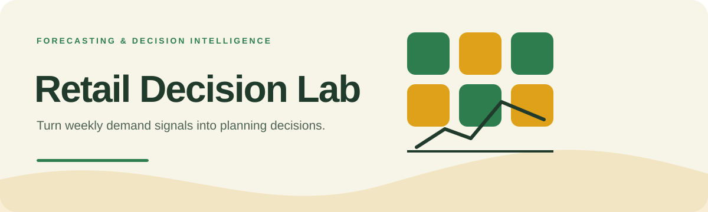
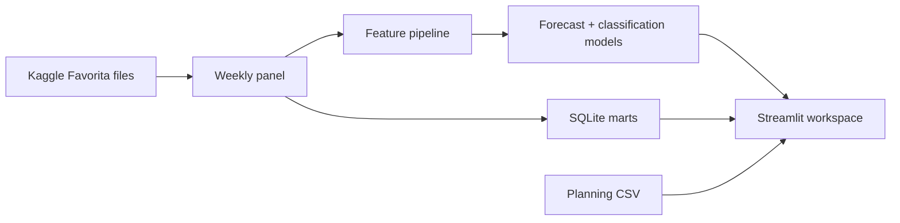

     

<strong>A Streamlit analytics workspace for demand forecasting, promotion analysis, SQL exploration, and one-week retail planning.</strong>

## Overview

A Streamlit analytics workspace for demand forecasting, promotion analysis, SQL exploration, and one-week retail planning.

### Why it matters

Retail Decision Lab connects model development to the questions a planner actually asks—what demand is changing, where it is changing, and how to prepare the next-week plan.

## Key features

- Forecast monitoring and executive demand views
- Store and product-family exploration
- Promotion and demand-spike analysis
- Upload-based next-week planning workflow
- SQLite marts for reusable business queries

## Architecture

## Technology stack

**python** · **streamlit** · **pandas** · **scikit learn** · **sqlite** · **docker**

## Getting started

Create a Python 3.13 environment, install `requirements.txt`, and place the official Favorita files under `data/raw/favorita/`. Run `python run_favorita_pipeline.py`, then `streamlit run app/main.py`.
